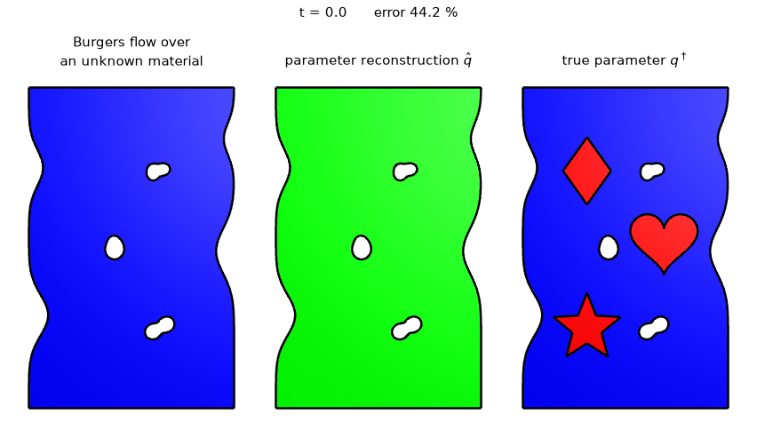
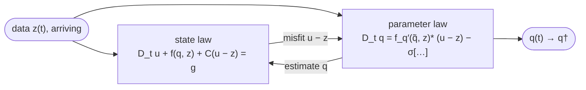
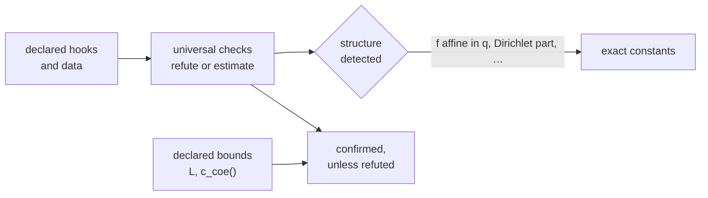

<p align="center">
  
</p>

<p align="center">
  <a href="https://github.com/CAarset/MRASLive/actions/workflows/tests.yml"></a>
  <a href="https://www.python.org"></a>
  <a href="https://ngsolve.org"></a>
  <a href="https://doi.org/10.3934/ammc.2026005"></a>
  <a href="LICENSE"></a>
</p>

<p align="center">
  <b>Online parameter identification for time-dependent PDEs, by model reference adaptation.</b>
</p>

<p align="center">
  <a href="#how-it-works">How it works</a> ·
  <a href="#installation">Installation</a> ·
  <a href="#quick-start">Quick start</a> ·
  <a href="#examples">Examples</a> ·
  <a href="#verification">Verification</a> ·
  <a href="#citation">Citation</a>
</p>

---

Data of a state arrive over time; a parameter of the equation behind them is unknown. MRAS runs a copy of the model alongside the data, nudged towards them, and lets the mismatch drive an estimate of the parameter, step by step as the data come in. No adjoint solves and no pass over the whole record are needed. This repository turns the method into a toolbox: you declare the physics, and it builds the forward model, the estimator and its solves, and checks the theory's assumptions for your problem.

<p align="center">
  
  <br>
  <sub>Vector Burgers flow up a channel with three barriers. Left: the flow speed the data show, on a logarithmic scale. Middle: the viscosity MRAS reconstructs from those data as they arrive. Right: the true viscosity. Noise-free data, <i>t</i> = 0 to 25, on a mesh of width 0.025.</sub>
</p>

## How it works

For `D_t u + f(q, u) = g` with data `z ≈ u†`, the model reference adaptive system of [Kaltenbacher & Nguyen (2021)](#citation) evolves a state `u` and an estimate `q` together:

$$
\begin{aligned}
D_t q + \sigma\big[D_t z + f(q,z) - g\big] - f_q'(\tilde q,z)^*(u-z) &= 0,\\
D_t u + f(q,z) + \mathcal{C}(u-z) &= g,
\end{aligned}
$$

with σ = 1 for `f` nonlinear in `q`, σ = 0 allowed for `f` affine in `q`, and a tracking operator `C` that pulls `u` towards the data. Under the assumptions (A1)–(A3) of [Kaltenbach, Aarset & Nguyen (2026)](#citation) with σ = 1, or persistently exciting data for `f` affine in `q`, `q → q†` and `u → u†`.



## Highlights

- **Physics-driven via finite elements.** A problem declares its model as weak-form densities; the driver builds the data model and executes the MRAS step
- **Handles real data.** MRAS is designed to handle real-world, noisy time series data, automatically regularising; it can also generate its own data for synthetic benchmarks 
- **Theory checked, not assumed.** Every problem verifies the theoretical requirements of MRAS, reporting what can and cannot be guaranteed [More below](#verification).
- **Watch it run.** A live seven-panel view in the notebook, movies rendered from HDF5 checkpoints, and exact restarts from them.

## Installation

```bash
python3 -m venv .venv
.venv/bin/pip install -e ".[notebook,dev]"
```

[ngsplot](https://github.com/CAarset/ngsplot) and [ngsrng](https://github.com/CAarset/ngsrng) are installed from GitHub, at the latest commit of each. Movies need `ffmpeg`. The Darcy example reads one PDEBench file:

```bash
mkdir -p data && curl -L -o data/2D_DarcyFlow_beta100.0_Train.hdf5 \
  https://darus.uni-stuttgart.de/api/access/datafile/133221   # md5 7c09f3b1bb097737d3fd52ffb0c6f1c8
```

## Quick start

```bash
.venv/bin/python -m mras.live burgers_2d --quick --noise-levels 0 0.05   # one example, small
.venv/bin/python scripts/run_examples.py burgers_2d                      # full size, with movie
```

```python
from mras.live import build

prob = build("arrhenius", h=0.5, tend=10.0)   # the example's defaults, overridden
for r in prob.run(noise_levels=[0.0, 0.05]):
    print(r.noise_level, r.final_error_q)
```

Or open [`notebooks/mras_live.ipynb`](notebooks/mras_live.ipynb) and watch an estimate converge.

## Examples

| example | equation, parameter `q` | |
|---|---|---|
| `darcy` | time-dependent Darcy flow, permeability from PDEBench | AMMC §4 |
| `fisher` | Fisher-type reaction–diffusion, diffusivity | AMMC Figs 5–6 |
| `potential` | diffusion with a potential nonlinear in `q` | AMMC §5.2 |
| `allen_cahn` | modified Allen–Cahn, nonlinear in `u` and `q` | AMMC §5.3 |
| `arrhenius`, `arrhenius_linear`, `arrhenius_sigma1` | reaction rate `q(x) r(u)`: every assumption verifiable | |
| `burgers_1d`, `burgers_1d_dark` | scalar Burgers in a perforated pipe, diffusivity | |
| `burgers_2d` | vector Burgers up a channel with barriers, viscosity (above) | |
| `blank_reaction` | the template: copy [`examples/blank_problem.py`](examples/blank_problem.py) | |

## Your own problem

Copy [`examples/blank_problem.py`](examples/blank_problem.py) and fill in its four marked blocks. A problem declares its physics and nothing else:

| hook | declares |
|---|---|
| `model(u, w)`, `model_boundary(u, w)` | the `q`-free part `⟨f(0, u), w⟩` |
| `coupling(q, u, w)`, `coupling_adjoint(q, u, w)` | the `q`-dependent part and its derivative's adjoint (required) |
| `source(t)`, `dirichlet(t)`, `u0`, `q_true` | forcing, boundary data, initial state, truth (for synthetic data) |
| `C_scale`, `tracking_boundary(u, w)` | the tracking operator `C`, `−Δ` by default |
| `sigma`; optionally `L`, `c_coe()` | the MRAS variant; analytic claims the checklist tests |

Add a `PROBLEM = MyProblem` marker and a `DEFAULTS` dict, and `python -m mras.live <name>` runs it. The constructor names anything missing.

## Verification

`mras/verify.py` asks every problem the same questions, at its audit discretization: the adjoint pairing of the assembled step, (A1)–(A3), persistent excitation of the data, the convergence statement for the declared σ, descent and reproducibility. Each answer is `ok`, `fail`, `estimated`, `deviation` or `unverifiable`, never a silent skip.



```bash
.venv/bin/python scripts/checklist.py       # every example -> results/checklist.md
```

The tiers and the theory behind each check are set out in the docstring of [`mras/verify.py`](mras/verify.py).

## Reproducing results

| | command |
|---|---|
| AMMC Fig 4, Table 6 (Darcy) | `scripts/darcy_reproduce.py`, then `scripts/make_figures.py --problem darcy` |
| AMMC Table 7, Figs 5–8 | `scripts/reproduce.py --problem fisher` / `--problem potential`, then `make_figures.py` |
| AMMC Table 8, Figs 9–11 | `scripts/reproduce.py --problem allen_cahn`, then `make_figures.py` |
| every example, every noise level | `scripts/run_examples.py` (resumable; `--resume`, `--movie-from`) |
| the animation above | `scripts/readme_media.py` |

The paper's reproduction scripts take `--micro` for a seconds-long wiring check; their full-size runs take hours per noise level.

## Repository layout

```
mras/        the toolbox: scheme, forward model, solvers, noise and smoothing,
             live view, movies, checkpoints, theory checklist, excitation maps
examples/    one file per problem, plus the blank template
configs/     YAML run configurations
scripts/     runners, paper reproductions, checklist, diagnostics
notebooks/   the live notebook
tests/       pytest suite (.venv/bin/pytest -q)
docs/media/  the animation above
```

## Citation

If you use MRASLive, please cite the software ([`CITATION.cff`](CITATION.cff)) and the papers it implements.

```bibtex
@software{MRASLive,
  author  = {Kaltenbach, Benedikt and Aarset, Christian and Nguyen, Tram Thi Ngoc},
  title   = {{MRASLive}: online parameter identification for time-dependent {PDEs} by model reference adaptation},
  year    = {2026},
  version = {0.1.0},
  url     = {https://github.com/CAarset/MRASLive},
  license = {MIT}
}

@article{KaltenbachAarsetNguyen2026,
  author  = {Kaltenbach, Benedikt and Aarset, Christian and Nguyen, Tram Thi Ngoc},
  title   = {Data assimilation via model reference adaptation for linear and nonlinear dynamical systems},
  journal = {Applied Mathematics for Modern Challenges},
  volume  = {8},
  pages   = {80--112},
  year    = {2026},
  doi     = {10.3934/ammc.2026005}
}

@article{KaltenbacherNguyen2021,
  author  = {Kaltenbacher, Barbara and Nguyen, Tram Thi Ngoc},
  title   = {A model reference adaptive system approach for nonlinear online parameter identification},
  journal = {Inverse Problems},
  volume  = {37},
  number  = {5},
  pages   = {055006},
  year    = {2021}
}
```

## License

[MIT](LICENSE), for every version of this repository, including its earliest commits. The code it grew from, the authors' earlier [MRAS](https://github.com/CAarset/MRAS) code, was first released under [CC BY 4.0](https://creativecommons.org/licenses/by/4.0/); its copyright holders, the authors named in [LICENSE](LICENSE), release it as contained here under the MIT License as well.
